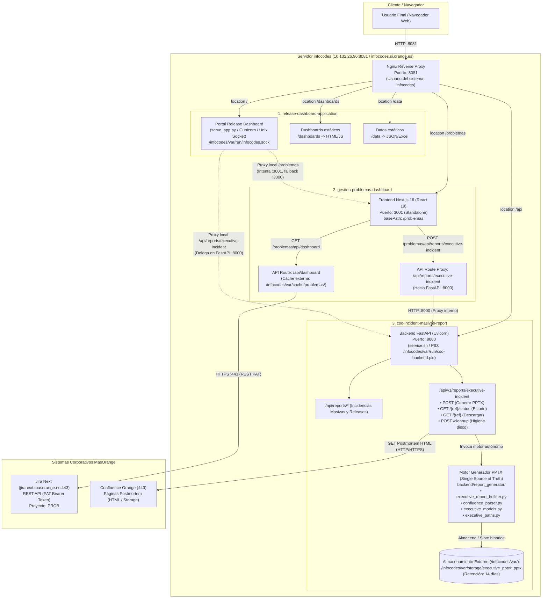
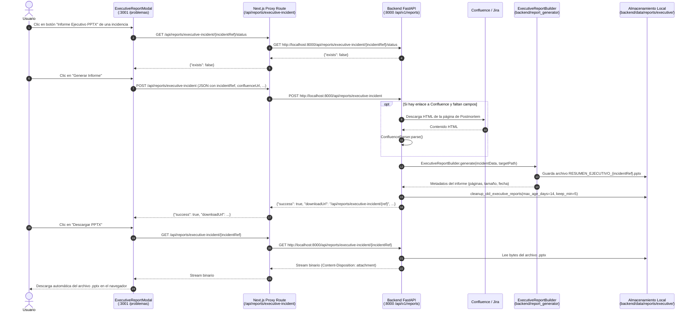
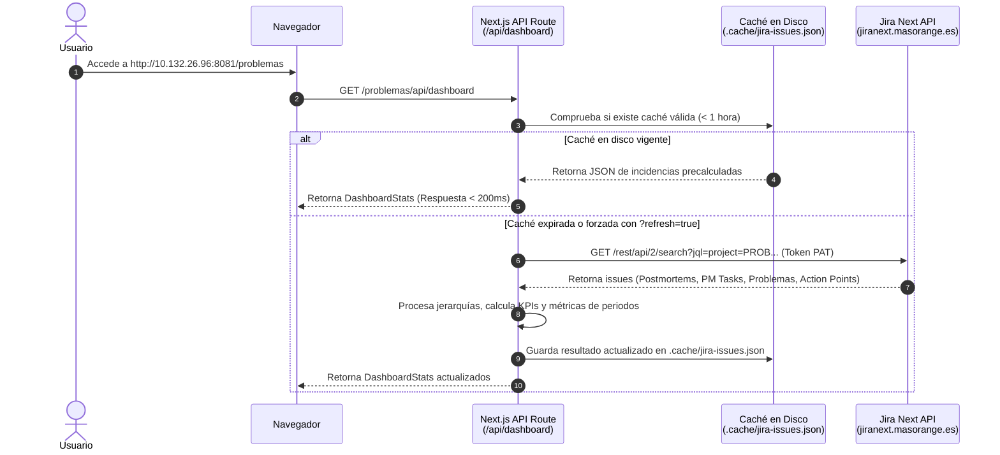

# Arquitectura del Sistema: Gestión de Problemas y Portal de Incidencias

> 📋 **Control de Evolución y Mejoras**: Consulta la hoja de ruta por fases y el estado de avances en **[ARCHITECTURE_ROADMAP.md](./ARCHITECTURE_ROADMAP.md)**.

Este documento describe la arquitectura global, topología de red, componentes, APIs y flujos de comunicación entre los tres proyectos interconectados:
1. **`release-dashboard-application`** (Portal Central y Conversores de Releases)
2. **`gestion-problemas-dashboard`** (Dashboard Next.js de Gestión de Problemas)
3. **`cso-incident-masivas-report`** (Backend FastAPI y Motor Single Source of Truth de Informes Ejecutivos PPTX)

---

## 1. Diagrama de Arquitectura Global



---

## 2. Matriz de Puertos, Protocolos y Rutas

| Componente / Servicio | Puerto Interno | Puerto Público | Protocolo | Endpoint / Upstream Nginx | Descripción |
| :--- | :--- | :--- | :--- | :--- | :--- |
| **Nginx (Frontend Unificado)** | `8081` | `8081` | HTTP | `http://10.132.26.96:8081` | Punto de entrada unificado para todas las aplicaciones |
| **Portal Release Dashboard** | Unix Socket | `8081` | HTTP (Sock) | `location /` -> `unix:/infocodes/var/run/infocodes.sock` | Portal general de releases y aplicaciones |
| **Dashboard de Problemas** | `3001` | `8081` | HTTP Proxy | `location /problemas` -> `http://localhost:3001` | Next.js App (React 19, Turbopack, Tailwind) |
| **Backend Informes (FastAPI)** | `8000` | `8081` | HTTP Proxy | `location /api` -> `http://localhost:8000` | FastAPI con endpoints REST y generador PPTX |
| **Jira Next (MasOrange)** | `443` | - | HTTPS | `https://jiranext.masorange.es/rest/api/2` | Invocado por Next.js usando Personal Access Token |
| **Confluence (MasOrange)** | `443` | - | HTTPS | URLs de postmortems vinculadas a las incidencias | Invocado por FastAPI para extraer impacto y causas |

---

## 3. Descripción de Componentes

### 3.1. `release-dashboard-application` (Portal Central y Conversores de Releases)
* **Función**: Actúa como portal de entrada a los dashboards estáticos de incidencias masivas y releases, y provee los conversores de CSV e informes KPI de releases (`generate_postmortem_report.py`).
* **`serve_app.py`**:
  - Servidor de aplicaciones web que atiende peticiones del portal en local (`:8080`).
  - Implementa un **Proxy Inverso Dual** para la ruta `/problemas`:
    - Intenta conectar al puerto **`3001`** (puerto estándar de producción de Next.js).
    - Si no responde, realiza un fallback automático al puerto **`3000`**.
  - **Delegación de Informes Ejecutivos (Fase 1.1)**:
    - Redirige cualquier petición a `/api/reports/executive-incident` o `/api/v1/reports/executive-incident` directamente al backend propietario FastAPI (`FASTAPI_BACKEND_URL`, por defecto `http://127.0.0.1:8000`), y en caso de desarrollo offline sin FastAPI levantado, consume directamente el paquete Single Source of Truth desde `../cso-incident-masivas-report/backend/report_generator`.
  - Los antiguos módulos `executive_*` en `converters/src/report_generator/` se mantienen únicamente como *shims* de re-exportación deprecados hacia `cso-incident-masivas-report`.

---

### 3.2. `gestion-problemas-dashboard` (Dashboard de Gestión de Problemas)
* **Tecnología**: Next.js 16 (App Router, Turbopack, React 19, TypeScript, Chart.js).
* **Configuración de Producción**:
  - Servido bajo el subpath `/problemas` mediante `NEXT_PUBLIC_BASE_PATH=/problemas`.
  - Escucha en el puerto **`3001`**, gestionado mediante `start.sh` / `restart.sh` / `status.sh` en modo standalone.
* **Capas del Proyecto**:
  - **Frontend**:
    - **Pestaña General**: Resumen ejecutivo cruzado de Postmortems, PM Tasks, Problemas y Action Points.
    - **Pestañas Especializadas**: Postmortems, PM Tasks de postmortem, Problemas y Action Points.
    - **Gráficos y KPIs**: Backlog acumulado, entradas vs resueltas por día, tiempo medio de resolución y agrupación por estado / grupo asignado.
    - **Modal de Informe Ejecutivo (`ExecutiveReportModal.tsx`)**: Integrado en la tabla de incidencias; permite comprobar estado, solicitar generación al backend FastAPI y descargar directamente el `.pptx`.
  - **API Routes (BFF - Backend for Frontend)**:
    - `GET /api/dashboard`: Obtiene las incidencias del proyecto `PROB` de Jira mediante REST API. Cuenta con un sistema de **doble nivel de caché** (memoria + persistencia en disco gestionada por `lib/cache-paths.ts` en `CACHE_DIR`, por defecto `/infocodes/var/cache/problemas/` en producción y `.cache/` en desarrollo local, con migración transparente sin pérdida de datos y precalentamiento por `refresh-cache.sh`) que reduce el tiempo de respuesta de más de 20 segundos a menos de 200 milisegundos.
    - `POST /api/reports/executive-incident` y `GET /api/reports/executive-incident/[...slug]`: Rutas proxy que redirigen las peticiones de informe ejecutivo al backend FastAPI (`BACKEND_REPORTS_URL`, por defecto `http://localhost:8000`).

---

### 3.3. `cso-incident-masivas-report` (Backend FastAPI y Motor PPTX — Single Source of Truth)
* **Tecnología**: FastAPI + Uvicorn (Python 3.10+).
* **Puerto**: **`8000`** (`BACKEND_PORT=8000`).
* **Motor Generador de Informes Ejecutivos (`backend/report_generator/`)**:
  - **Propietario único (Fase 1.1)** de la lógica de generación PowerPoint de incidencias ejecutivas:
    - `executive_models.py`: Modelos de dominio (`ExecutiveIncidentData`, `ActionPoint`, `ExecutiveReportMetadata`), sanitización de referencias y extractor heurístico de descripciones de Jira.
    - `confluence_parser.py`: Parsea contenido HTML exportado o descargado de páginas de postmortem en Confluence (título, resumen, impacto de negocio, causa raíz, línea temporal, acciones tomadas).
    - `executive_report_builder.py`: Genera presentaciones PowerPoint (`.pptx`) en formato panorámico 16:9 usando `assets/executive_template.pptx`, paleta corporativa Orange (`#F16E00`, `#000000`), renderizado `matplotlib` (`Agg`) y prevención dinámica de solapes.
    - `executive_paths.py`: Gestiona la ruta de plantilla, el directorio de salida desacoplado del código fuente (`EXECUTIVE_REPORTS_OUTPUT_DIR` / `EXECUTIVE_REPORTS_DIR`, por defecto `/infocodes/var/storage/executive_pptx/` en producción y `backend/data/reports/executive/` en local, con migración automática de `.pptx` legados) y la rutina `cleanup_old_executive_reports`.
* **Endpoints de Informes Ejecutivos (`/api/v1/reports/executive-incident` y `/api/reports/executive-incident`)**:
  - `POST /api/v1/reports/executive-incident`:
    - Recibe el identificador de incidencia (`incidentRef`), título, enlace a Confluence y datos complementarios.
    - Descarga y analiza la página de Confluence o utiliza la extracción heurística de la descripción de Jira como fallback.
    - Si el informe ya existe en disco y no se fuerza regeneración (`force=false`), devuelve inmediatamente la referencia en caché.
    - Si se genera de nuevo, invoca a `ExecutiveReportBuilder`, almacena el `.pptx` en disco (`RESUMEN_EJECUTIVO_{incidentRef}.pptx`) y ejecuta automáticamente la rutina de higiene para eliminar informes con más de 14 días.
  - `GET /api/v1/reports/executive-incident/{incident_ref}/status`:
    - Comprueba si el informe ya está compilado en disco.
  - `GET /api/v1/reports/executive-incident/{incident_ref}`:
    - Retorna el flujo binario del archivo PowerPoint con cabecera `Content-Type: application/vnd.openxmlformats-officedocument.presentationml.presentation` y `Content-Disposition: attachment`.
  - `POST /api/v1/reports/executive-incident/cleanup`:
    - Endpoint manual o programado para purga de informes antiguos con parámetros `max_age_days` (defecto 14) y `keep_min` (defecto 5).

---

## 4. Flujos de Secuencia

### 4.1. Generación y Descarga del Informe Ejecutivo PPTX



---

### 4.2. Carga y Caché de Datos de Jira en el Dashboard



---

## 5. Configuración de Nginx en Producción

El servidor comparte un único puerto de entrada (**`8081`**) mediante Nginx (`/infocodes/nginx/conf/nginx.conf`):

```nginx
# Upstream para FastAPI backend (cso-incident-masivas-report)
upstream fastapi_backend {
    server localhost:8000;
}

# Upstream para Dashboard de Gestión de Problemas (Next.js en PM2)
upstream gestion_problemas_backend {
    server localhost:3001;
}

server {
    listen 8081 default_server;
    server_name 10.132.26.96 infocodes.si.orange.es;

    # Portal Principal
    location / {
        proxy_pass http://unix:/infocodes/var/run/infocodes.sock;
    }

    # Dashboards Estáticos
    location /dashboards {
        alias /infocodes/project/release-dashboard-application/dashboards;
        index index.html;
    }

    # Dashboard de Gestión de Problemas (Next.js)
    location /problemas {
        proxy_pass http://gestion_problemas_backend;
        proxy_set_header Host $host;
        proxy_set_header X-Real-IP $remote_addr;
        proxy_set_header X-Forwarded-For $proxy_add_x_forwarded_for;
        proxy_set_header X-Forwarded-Proto $scheme;
    }

    # API Backend (FastAPI)
    location /api {
        proxy_pass http://fastapi_backend;
        proxy_set_header Host $host;
        proxy_set_header X-Real-IP $remote_addr;
        proxy_set_header X-Forwarded-For $proxy_add_x_forwarded_for;
        proxy_set_header X-Forwarded-Proto $scheme;
        proxy_connect_timeout 60s;
        proxy_read_timeout 60s;
    }
}
```

---

## 6. Variables de Entorno Clave

### `gestion-problemas-dashboard` (`.env.local` / `.env.production.local`)
| Variable | Valor Típico | Propósito |
| :--- | :--- | :--- |
| `NEXT_PUBLIC_BASE_PATH` | `/problemas` | Prefijo de ruta web para servir detrás de Nginx |
| `NEXT_PUBLIC_JIRA_DOMAIN` | `jiranext.masorange.es` | Dominio de la instancia de Jira de MasOrange |
| `JIRA_API_TOKEN` | *`<PAT_TOKEN>`* | Token de Acceso Personal para autenticación con Jira |
| `NEXT_PUBLIC_JIRA_PROJECT_KEY`| `PROB` | Código del proyecto de problemas en Jira |
| `BACKEND_REPORTS_URL` | `http://localhost:8000` | URL interna del backend FastAPI para generar PPTX |
| `CACHE_DIR` | `/infocodes/var/cache/problemas` | Directorio externo para `dashboard_stats.json` y `jira_wiki_links.json` (fallback: `.cache`) |

### `cso-incident-masivas-report` (`backend/.env` / `service.sh`)
| Variable | Valor Típico | Propósito |
| :--- | :--- | :--- |
| `PORT` / `BACKEND_PORT` | `8000` | Puerto en el que escucha Uvicorn / FastAPI |
| `RELOAD` | `false` | Desactivar reload automático en producción |
| `EXECUTIVE_REPORTS_OUTPUT_DIR` | `/infocodes/var/storage/executive_pptx` | Directorio externo de persistencia de informes `.pptx` (fallback: `backend/data/reports/executive`) |

### `release-dashboard-application` (`.env`)
| Variable | Valor Típico | Propósito |
| :--- | :--- | :--- |
| `NEXTJS_PROBLEMAS_URL` | `http://localhost:3001` | URL objetivo a la que `serve_app.py` redirige `/problemas` |
| `FASTAPI_BACKEND_URL` | `http://127.0.0.1:8000` | URL objetivo a la que `serve_app.py` delega `/api/reports/executive-incident` |

---

## 7. Gestión de Procesos y Persistencia en Producción

Dado que el servidor opera bajo el usuario de sistema `infocodes` sin permisos de `root` ni `systemd`:
1. **Next.js** se gestiona mediante **PM2 en modo usuario**:
   ```bash
   npx pm2 start ecosystem.config.js
   npx pm2 save
   ```
2. **Persistencia tras reinicio de la máquina**: Se configura una entrada en el `crontab` del usuario `infocodes`:
   ```bash
   @reboot cd /infocodes/project/gestion-problemas-dashboard && PATH=/infocodes/nodejs/bin:$PATH npx pm2 resurrect
   ```
3. **Backend FastAPI**: Se arranca mediante PM2 o script de arranque en segundo plano (`nohup python3 -m uvicorn main:app --host 0.0.0.0 --port 8000 &`).

