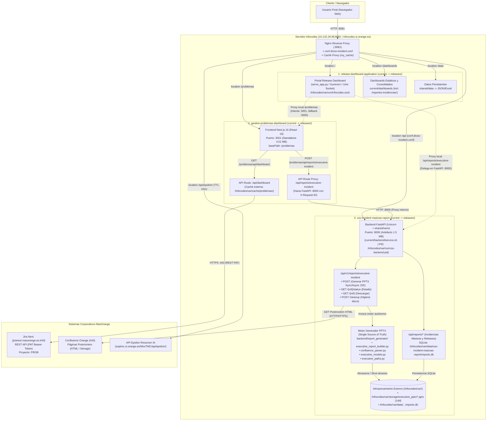
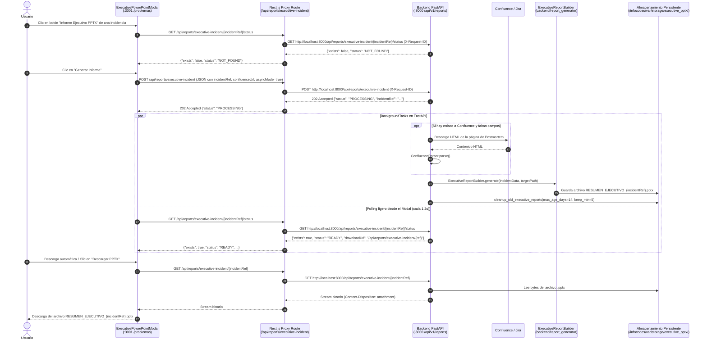
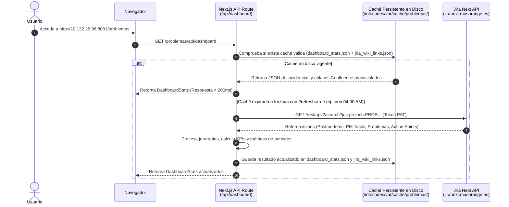

# Arquitectura del Sistema: Gestión de Problemas y Portal de Incidencias

> 📋 **Control de Evolución y Mejoras**: Consulta la hoja de ruta por fases y el estado de avances en **[ARCHITECTURE_ROADMAP.md](./ARCHITECTURE_ROADMAP.md)**.

Este documento describe la arquitectura global, topología de red, componentes, APIs y flujos de comunicación entre los tres proyectos interconectados:
1. **`release-dashboard-application`** (Portal Central y Conversores de Releases)
2. **`gestion-problemas-dashboard`** (Dashboard Next.js de Gestión de Problemas)
3. **`cso-incident-masivas-report`** (Backend FastAPI y Motor Single Source of Truth de Informes Ejecutivos PPTX)

---

## 1. Diagrama de Arquitectura Global



---

## 2. Matriz de Puertos, Protocolos y Rutas

| Componente / Servicio | Puerto Interno | Puerto Público | Protocolo | Endpoint / Upstream Nginx | Descripción |
| :--- | :--- | :--- | :--- | :--- | :--- |
| **Nginx (Frontend Unificado)** | `8081` | `8081` | HTTP | `http://10.132.26.96:8081` | Punto de entrada unificado con `conf.d/*.conf` y caché `my_cache` |
| **Portal Release Dashboard** | Unix Socket | `8081` | HTTP (Sock) | `location /` -> `unix:/infocodes/var/run/infocodes.sock` | Portal central, dashboards estáticos y UI de reportes de incidencias |
| **Dashboards Estáticos** | - | `8081` | Archivos | `location /dashboards` -> `.../current/dashboards` | Incluye `/dashboards/reportes-incidencias/` consolidado |
| **Dashboard de Problemas** | `3001` | `8081` | HTTP Proxy | `location /problemas` -> `http://127.0.0.1:3001` | Next.js 16 Standalone (React 19, Turbopack, Tailwind) |
| **Backend Informes (FastAPI)** | `8000` | `8081` | HTTP Proxy | `location /api` -> `http://localhost:8000` (`cso-incident.conf`) | FastAPI con endpoints REST, SQLite y motor único PPTX |
| **Proxy Epsilon Resumen IA** | `443` | `8081` | HTTPS Proxy | `location /api/epsilon/` -> `soptmc.si.orange.es` | Proxy inverso con caché compartida (`15m` TTL) y anti-saturación |
| **Jira Next (MasOrange)** | `443` | - | HTTPS | `https://jiranext.masorange.es/rest/api/2` | Invocado por Next.js usando Personal Access Token |
| **Confluence (MasOrange)** | `443` | - | HTTPS | URLs de postmortems vinculadas a las incidencias | Invocado por FastAPI para extraer impacto y causas |

---

## 3. Descripción de Componentes

### 3.1. `release-dashboard-application` (Portal Central, Dashboards Consolidados y Conversores)
* **Función**: Actúa como portal de entrada unificado a los dashboards de releases, problemas e incidencias masivas, centralizando tokens de diseño, utilidades de fecha, notificaciones (`Toast`) y estado en vivo en la barra superior (`live topbar status`).
* **Consolidación de Frontends**:
  - Aloja el frontend de **Reportes Semanales de Incidencias** directamente en `dashboards/reportes-incidencias/` (`/dashboards/reportes-incidencias/`), eliminando duplicidades de assets estáticos entre repositorios.
* **Despliegue por Artefacto Ligero (`2.3 MB`) y Releases Atómicas**:
  - Empaqueta exclusivamente los archivos de runtime en `dist/release-dashboard-runtime.tar.gz` (`~2.3 MB`) mediante `scripts/package-standalone.js` y despliega en 1 clic con `scripts/deploy-production.ps1` sobre `/infocodes/project/release-dashboard-application/releases/<TIMESTAMP>` activando el symlink `current`.
* **`serve_app.py`**:
  - Servidor de aplicaciones web que atiende peticiones del portal en local (`:8080`) y en producción mediante socket Unix (`/infocodes/var/run/infocodes.sock`).
  - Implementa un **Proxy Inverso Dual** para la ruta `/problemas` (con sonda `/api/problemas-status`):
    - Intenta conectar al puerto **`3001`** (puerto estándar de producción de Next.js).
    - Si no responde, realiza un fallback automático al puerto **`3000`**.
  - **Delegación de Informes Ejecutivos (Fase 1.1)**:
    - Redirige cualquier petición a `/api/reports/executive-incident` o `/api/v1/reports/executive-incident` directamente al backend propietario FastAPI (`FASTAPI_BACKEND_URL`, por defecto `http://127.0.0.1:8000`), y en caso de desarrollo offline sin FastAPI levantado, consume directamente el paquete Single Source of Truth desde `../cso-incident-masivas-report/backend/report_generator`.
  - Los antiguos módulos `executive_*` en `converters/src/report_generator/` se mantienen únicamente como *shims* de re-exportación deprecados hacia `cso-incident-masivas-report`.

---

### 3.2. `gestion-problemas-dashboard` (Dashboard de Gestión de Problemas)
* **Tecnología**: Next.js 16 (App Router, Turbopack, React 19, TypeScript, Chart.js).
* **Configuración de Producción y Artefacto Ultraligero (`4.01 MB`)**:
  - Servido bajo el subpath `/problemas` mediante `NEXT_PUBLIC_BASE_PATH=/problemas`.
  - Escucha en el puerto **`3001`**, gestionado mediante `start.sh` / `restart.sh` / `status.sh` / `rollback.sh` operando sobre el symlink atómico `current -> releases/<TIMESTAMP>`.
  - El empaquetador [`scripts/prepare-standalone.js`](./scripts/prepare-standalone.js) aplica una **lista blanca estricta de runtime** sobre `.next/standalone` (y anotaciones `/*turbopackIgnore: true*/` en [`lib/cache-paths.ts`](./lib/cache-paths.ts)), reduciendo el tamaño de `dist/gestion-problemas-standalone.tar.gz` de **`37.25 MB` a `4.01 MB` (-89%)** y garantizando que el directorio de producción no contenga código fuente ni archivos de desarrollo.
* **Capas del Proyecto**:
  - **Frontend**:
    - **Pestaña General**: Resumen ejecutivo cruzado de Postmortems, PM Tasks, Problemas y Action Points.
    - **Pestañas Especializadas**: Postmortems, PM Tasks de postmortem, Problemas y Action Points.
    - **Gráficos y KPIs**: Backlog acumulado, entradas vs resueltas por día, tiempo medio de resolución y agrupación por estado / grupo asignado.
    - **Modal de Informe Ejecutivo (`ExecutivePowerPointModal.tsx` / `ExecutiveReportModal.tsx`)**: Integrado en la tabla de incidencias; permite comprobar estado, solicitar generación síncrona o asíncrona (`202 Accepted` con polling cada `1.2s`) al backend FastAPI y descargar directamente el `.pptx`.
  - **API Routes (BFF - Backend for Frontend)**:
    - `GET /api/dashboard`: Obtiene las incidencias del proyecto `PROB` de Jira mediante REST API. Cuenta con un sistema de **doble nivel de caché** (memoria + persistencia en disco gestionada por [`lib/cache-paths.ts`](./lib/cache-paths.ts) en `CACHE_DIR`, por defecto `/infocodes/var/cache/problemas/` en producción y `.cache/` en desarrollo local, con migración transparente sin pérdida de datos y precalentamiento por `refresh-cache.sh`) que reduce el tiempo de respuesta de más de 20 segundos a menos de 200 milisegundos.
    - `POST /api/reports/executive-incident` y `GET /api/reports/executive-incident/[...slug]`: Rutas proxy que redirigen las peticiones de informe ejecutivo al backend FastAPI (`BACKEND_REPORTS_URL`, por defecto `http://localhost:8000`) propagando la cabecera de trazabilidad `X-Request-ID`.

---

### 3.3. `cso-incident-masivas-report` (Backend FastAPI y Motor PPTX — Single Source of Truth)
* **Tecnología**: FastAPI + Uvicorn (Python 3.10+, SQLAlchemy + SQLite).
* **Puerto**: **`8000`** (`BACKEND_PORT=8000`).
* **Despliegue Standalone (`1.5 MB`), Releases Atómicas y `shared/venv`**:
  - Empaqueta el backend en `dist/cso-incident-backend.tar.gz` (`~1.5 MB`) mediante `scripts/package-standalone.js` y lo despliega en 1 clic con `scripts/deploy-production.ps1`.
  - Opera bajo `/infocodes/project/cso-incident-masivas-report/current -> releases/<TIMESTAMP>`, reutilizando el entorno virtual Python persistente en `shared/venv` y la configuración en `shared/.env`.
  - Gestiona su propio bloque de Nginx en `/infocodes/nginx/conf/conf.d/cso-incident.conf` y cuenta con scripts `status.sh` y `rollback.sh` en la raíz del proyecto, además de `current/backend/service.sh` y `current/backend/maintenance.sh`.
  - Resuelve dinámicamente la ruta `release-dashboard-application/current` (`find_release_dashboard_root`) y extiende `report_generator.__path__` para compatibilidad con generadores compartidos.
* **Motor Generador de Informes Ejecutivos (`backend/report_generator/`)**:
  - **Propietario único (Fase 1.1)** de la lógica de generación PowerPoint de incidencias ejecutivas:
    - `executive_models.py`: Modelos de dominio (`ExecutiveIncidentData`, `ActionPoint`, `ExecutiveReportMetadata`), sanitización de referencias y extractor heurístico de descripciones de Jira.
    - `confluence_parser.py`: Parsea contenido HTML exportado o descargado de páginas de postmortem en Confluence (título, resumen, impacto de negocio, causa raíz, línea temporal, acciones tomadas).
    - `executive_report_builder.py`: Genera presentaciones PowerPoint (`.pptx`) en formato panorámico 16:9 usando `assets/executive_template.pptx`, paleta corporativa Orange (`#F16E00`, `#000000`), renderizado `matplotlib` (`Agg`) y prevención dinámica de solapes.
    - `executive_paths.py`: Gestiona la ruta de plantilla, el directorio de salida desacoplado del código fuente (`EXECUTIVE_REPORTS_OUTPUT_DIR` / `EXECUTIVE_REPORTS_DIR`, por defecto `/infocodes/var/storage/executive_pptx/` en producción y `backend/data/reports/executive/` en local, con migración automática de `.pptx` legados) y la rutina `cleanup_old_executive_reports`.
* **Endpoints de Informes Ejecutivos (`/api/v1/reports/executive-incident` y `/api/reports/executive-incident`)**:
  - `POST /api/v1/reports/executive-incident`:
    - Recibe el identificador de incidencia (`incidentRef`), título, enlace a Confluence y datos complementarios.
    - Soporta ejecución asíncrona (`asyncMode=true` -> `202 Accepted` con `BackgroundTasks` y estados `PROCESSING` -> `READY` / `FAILED`) y síncrona (`200 OK`).
    - Descarga y analiza la página de Confluence o utiliza la extracción heurística de la descripción de Jira como fallback.
    - Si el informe ya existe en disco y no se fuerza regeneración (`force=false`), devuelve inmediatamente la referencia en caché.
    - Si se genera de nuevo, invoca a `ExecutiveReportBuilder`, almacena el `.pptx` en disco (`RESUMEN_EJECUTIVO_{incidentRef}.pptx`) y ejecuta automáticamente la rutina de higiene para eliminar informes con más de 14 días.
  - `GET /api/v1/reports/executive-incident/{incident_ref}/status`:
    - Comprueba el estado del informe (`NOT_FOUND`, `PROCESSING`, `READY`, `FAILED`) y sus metadatos en disco.
  - `GET /api/v1/reports/executive-incident/{incident_ref}`:
    - Retorna el flujo binario del archivo PowerPoint con cabecera `Content-Type: application/vnd.openxmlformats-officedocument.presentationml.presentation` y `Content-Disposition: attachment`.
  - `POST /api/v1/reports/executive-incident/cleanup`:
    - Endpoint manual o programado para purga de informes antiguos con parámetros `max_age_days` (defecto 14) y `keep_min` (defecto 5).
  - Sondas de salud operativas en `/api/health`, `/healthz` y `/readyz`.

---

## 4. Flujos de Secuencia

### 4.1. Generación y Descarga del Informe Ejecutivo PPTX (Asíncrono / Síncrono)



---

### 4.2. Carga y Caché de Datos de Jira en el Dashboard



---

## 5. Configuración de Nginx en Producción

El servidor comparte un único puerto de entrada (**`8081`**) mediante Nginx (`/infocodes/nginx/conf/nginx.conf`) con inclusión modular de configuraciones por servicio (`/infocodes/nginx/conf/conf.d/*.conf`):

```nginx
# Upstream para FastAPI backend (cso-incident-masivas-report)
upstream fastapi_backend {
    server localhost:8000;
}

# Upstream para Dashboard de Gestión de Problemas (Next.js Standalone :3001)
upstream gestion_problemas_backend {
    server 127.0.0.1:3001;
}

server {
    listen 8081 default_server;
    server_name 10.132.26.96 infocodes.si.orange.es;

    # Cabeceras de seguridad
    add_header X-Content-Type-Options "nosniff" always;
    add_header X-Frame-Options "SAMEORIGIN" always;
    add_header Referrer-Policy "strict-origin-when-cross-origin" always;

    # Dashboards Estáticos y Consolidados (vía symlink current)
    location /dashboards {
        alias /infocodes/project/release-dashboard-application/current/dashboards;
        index index.html index.htm;
        try_files $uri $uri/ /index.html;
    }

    # Dashboard de Gestión de Problemas (Next.js Standalone)
    location /problemas {
        proxy_pass http://gestion_problemas_backend;
        proxy_set_header Host $host;
        proxy_set_header X-Real-IP $remote_addr;
        proxy_set_header X-Forwarded-For $proxy_add_x_forwarded_for;
        proxy_set_header X-Forwarded-Proto $scheme;
        proxy_set_header X-Request-ID $request_id;
        add_header X-Request-ID $request_id always;
    }

    # Proxy para API Epsilon Resumen IA (evita CORS y previene saturación con caché compartida)
    location /api/epsilon/ {
        proxy_pass https://soptmc.si.orange.es/MonTMC/api/epsilon/;
        proxy_ssl_verify off;
        proxy_ssl_server_name on;
        proxy_set_header Host soptmc.si.orange.es;
        proxy_cache my_cache;
        proxy_cache_valid 200 15m;
        proxy_cache_use_stale error timeout updating http_500 http_502 http_503 http_504;
        add_header X-Cache-Status $upstream_cache_status always;
    }

    # Inclusión modular de aplicaciones hermanas (ej. conf.d/cso-incident.conf -> /api hacia FastAPI :8000)
    include /infocodes/nginx/conf/conf.d/*.conf;

    # Portal Principal (Gunicorn / serve_app.py)
    location / {
        include proxy_params;
        proxy_set_header X-Request-ID $request_id;
        proxy_pass http://unix:/infocodes/var/run/infocodes.sock;
        proxy_cache my_cache;
    }

    # Datos Persistentes Compartidos
    location /data {
        alias /infocodes/project/release-dashboard-application/shared/data;
        autoindex off;
    }
}
```

---

## 6. Variables de Entorno Clave

### `gestion-problemas-dashboard` (`shared/.env.local` / `shared/.env.production.local`)
| Variable | Valor Típico | Propósito |
| :--- | :--- | :--- |
| `NEXT_PUBLIC_BASE_PATH` | `/problemas` | Prefijo de ruta web para servir detrás de Nginx |
| `NEXT_PUBLIC_JIRA_DOMAIN` | `jiranext.masorange.es` | Dominio de la instancia de Jira de MasOrange |
| `JIRA_API_TOKEN` | *`<PAT_TOKEN>`* | Token de Acceso Personal para autenticación con Jira |
| `NEXT_PUBLIC_JIRA_PROJECT_KEY`| `PROB` | Código del proyecto de problemas en Jira |
| `BACKEND_REPORTS_URL` | `http://localhost:8000` | URL interna del backend FastAPI para generar PPTX |
| `CACHE_DIR` | `/infocodes/var/cache/problemas` | Directorio externo para `dashboard_stats.json` y `jira_wiki_links.json` (fallback: `.cache`) |

### `cso-incident-masivas-report` (`shared/.env` / `current/backend/service.sh`)
| Variable | Valor Típico | Propósito |
| :--- | :--- | :--- |
| `PORT` / `BACKEND_PORT` | `8000` | Puerto en el que escucha Uvicorn / FastAPI |
| `RELOAD` | `false` | Desactivar reload automático en producción |
| `DATABASE_URL` | `sqlite:////infocodes/var/data/cso-incident-masivas-report/reports.db` | Base de datos SQLite persistente fuera del árbol de releases |
| `EXECUTIVE_REPORTS_OUTPUT_DIR` | `/infocodes/var/storage/executive_pptx` | Directorio externo de persistencia de informes `.pptx` (fallback: `backend/data/reports/executive`) |

### `release-dashboard-application` (`.env`)
| Variable | Valor Típico | Propósito |
| :--- | :--- | :--- |
| `NEXTJS_PROBLEMAS_URL` | `http://localhost:3001` | URL objetivo a la que `serve_app.py` redirige `/problemas` |
| `FASTAPI_BACKEND_URL` | `http://127.0.0.1:8000` | URL objetivo a la que `serve_app.py` delega `/api/reports/executive-incident` |

---

## 7. Modelo Unificado de Releases Atómicas (`current -> releases/`), Artefactos Ultraligeros y Persistencia (`/infocodes/var/`)

Los **tres repositorios del ecosistema** comparten un patrón arquitectónico idéntico de despliegue en producción (**Zero Git in Production**), operando bajo el usuario de sistema `infocodes` sin permisos de `root` ni `systemd`:

### 7.1. Comparativa de Empaquetado y Releases por Servicio

| Proyecto | Artefacto Generado | Tamaño | Estructura en `/infocodes/project/<app>/` | Gestión de Proceso y Rollback |
| :--- | :--- | :---: | :--- | :--- |
| **`gestion-problemas-dashboard`** | `dist/gestion-problemas-standalone.tar.gz` | **`4.01 MB`** *(optimizado -89%)* | `current -> releases/<TS>`, `releases/` (3 últimas), `shared/.env.local` | `./start.sh`, `./stop.sh`, `./restart.sh`, `./status.sh`, `./rollback.sh`, `./refresh-cache.sh` |
| **`cso-incident-masivas-report`** | `dist/cso-incident-backend.tar.gz` | **`~1.5 MB`** | `current -> releases/<TS>`, `releases/` (3 últimas), `shared/venv`, `shared/.env` | `current/backend/service.sh`, `current/backend/maintenance.sh`, `./status.sh`, `./rollback.sh` |
| **`release-dashboard-application`** | `dist/release-dashboard-runtime.tar.gz` | **`~2.3 MB`** | `current -> releases/<TS>`, `releases/` (3 últimas), `shared/data/` | Gunicorn (`infocodes.sock`), `./status.sh`, `./rollback.sh` |

- **Despliegue en 1 Clic desde PowerShell**: Cada repositorio dispone de su propio `scripts/deploy-production.ps1` (con soporte para `-SkipBuild`, `-VerifyOnly` y `-Rollback`), además de la bandera `-IncludeBackend` en `gestion-problemas-dashboard` para despliegues coordinados.
- **Higiene en Producción**: Ningún servidor de producción clona repositorios Git ni ejecuta `npm ci` / `next build`. Los scripts de preparación aplican listas blancas estrictas para subir únicamente binarios y código de ejecución, limpiando automáticamente archivos residuales y rotando `releases/` para conservar solo las últimas 3 versiones limpias.

### 7.2. Mapa Completo de Almacenamiento Persistente (`/infocodes/var/` y `/infocodes/logs/`)

Todo el estado mutable reside fuera de las carpetas de las aplicaciones, garantizando **cero pérdida de datos** durante despliegues o rollbacks:

```text
/infocodes/var/
├── cache/
│   ├── problemas/                         # Caché Jira: dashboard_stats.json (~1.7 MB), jira_wiki_links.json (~19 KB)
│   └── nginx/                             # Caché de proxy Nginx (my_cache, incl. respuestas de /api/epsilon/)
├── data/
│   └── cso-incident-masivas-report/
│       └── reports.db                     # Base de datos SQLite principal de informes semanales y masivas
├── storage/
│   └── executive_pptx/                    # Presentaciones .pptx generadas (retención automática de 14 días)
├── run/
│   ├── gestion-problemas.pid              # PID de Next.js Standalone (:3001)
│   ├── cso-backend.pid                    # PID de FastAPI / Uvicorn (:8000)
│   ├── infocodes.sock                     # Unix socket de Gunicorn (release-dashboard-application)
│   └── nginx.pid                          # PID del proceso maestro de Nginx (:8081)
└── backups/
    ├── problemas-rollback.tar.gz          # Snapshot previo de gestion-problemas-dashboard
    ├── cso-incident-masivas-report/       # Backups automáticos de SQLite (reports.db)
    └── release-dashboard-application/     # Backups de datos y releases del portal

/infocodes/logs/
└── cso-incident-masivas-report/
    └── backend.log                        # Logs estructurados de FastAPI con X-Request-ID y X-Process-Time
```

---

## 8. Delimitación de Contratos API y Sincronización Tipada (Fase 3.1 y 3.2)

### 8.1. Frontera de Responsabilidades entre Servicios (Fase 3.1)
Para evitar duplicidad de lógica y mantener cada servicio enfocado en su dominio:
- **`gestion-problemas-dashboard` (Next.js 16 BFF en `:3001`)**:
  - **Único responsable de la integración con Jira (`jiranext.masorange.es`)**, cálculo de KPIs/agregaciones por periodo y gestión de la caché en `/infocodes/var/cache/problemas/` (`GET /problemas/api/dashboard`).
  - Actúa como **Proxy BFF con trazabilidad `X-Request-ID`** hacia FastAPI para las rutas `/problemas/api/reports/executive-incident/*`.
- **`cso-incident-masivas-report` (FastAPI en `:8000`)**:
  - **Único propietario (Single Source of Truth) del motor de informes ejecutivos PowerPoint (`.pptx`)**, de la persistencia SQLite (`reports.db`) y del conector/parser de Confluence (`GET/POST /api/v1/reports/executive-incident/*`).
  - Soporta ejecución síncrona (`200 OK`) y asíncrona mediante `BackgroundTasks` (`202 Accepted` con estado `PROCESSING` -> `READY`).
- **`release-dashboard-application` (Portal Central en Unix Socket)**:
  - **Único propietario del portal de entrada y de los frontends estáticos consolidados** (`/dashboards/*`, incluyendo `/dashboards/reportes-incidencias/`), tokens de diseño compartidos y conversores de releases.

### 8.2. Sincronización Automática `OpenAPI <-> TypeScript <-> Pydantic` (Fase 3.2)
El contrato formal entre ambos repositorios reside en [`contracts/executive-reports.openapi.json`](./contracts/executive-reports.openapi.json) y se valida automáticamente en cada compilación (`npm run build:standalone`) mediante [`scripts/sync-openapi-types.js`](./scripts/sync-openapi-types.js):
- `npm run check:contracts`: Verifica que [`types/executiveReport.ts`](./types/executiveReport.ts) y `cso-incident-masivas-report/backend/schemas.py` coincidan al 100% con el contrato OpenAPI.
- `npm run generate:types`: Regenera [`types/executiveReport.ts`](./types/executiveReport.ts) directamente desde la especificación OpenAPI.

---

## 9. Matriz de Gobernanza (RACI) y SLAs Operativos (Fase 3.3)

### 9.1. Matriz de Propiedad por Componente (RACI)
*(**R** = Responsible / Ejecutor, **A** = Accountable / Propietario, **C** = Consulted, **I** = Informed)*

| Componente / Ruta / Recurso | `gestion-problemas-dashboard` | `cso-incident-masivas-report` | `release-dashboard-application` | Infra / Nginx (`:8081`) |
| :--- | :---: | :---: | :---: | :---: |
| UI Dashboard y Filtros (`/problemas`) | **R / A** | I | I | C |
| Ingesta Jira y Caché (`/infocodes/var/cache/problemas`) | **R / A** | I | I | I |
| Proxy BFF de Informes (`/problemas/api/reports/*`) | **R / A** | C | I | I |
| Motor PPTX 16:9 y Parser Confluence (`/api/v1/reports/*`) | C | **R / A** | C (Shim) | I |
| Almacenamiento PPTX (`/infocodes/var/storage/executive_pptx`) | I | **R / A** | I | I |
| API y BBDD Incidencias Masivas (`/api/reports/*`, `reports.db`) | I | **R / A** | C | I |
| Portal Principal y UI Reportes (`/`, `/dashboards/reportes-incidencias`) | I | C | **R / A** | C |
| Enrutamiento Inverso, Caché Epsilon IA y `X-Request-ID` (`:8081`) | C | C | C | **R / A** |

### 9.2. Objetivos de Nivel de Servicio (SLAs Internos)

| Operación / Endpoint | Objetivo (SLO) | Mecanismo de Garantía |
| :--- | :--- | :--- |
| **Carga inicial del Dashboard** (`GET /problemas/api/dashboard`) | `< 250 ms` (p95) | Lectura directa desde caché precalentada en `/infocodes/var/cache/problemas/dashboard_stats.json` |
| **Solicitud de Informe Ejecutivo** (`POST /api/reports/executive-incident`) | `< 300 ms` (HTTP `202`) | Encolado asíncrono con `BackgroundTasks` (`status: "PROCESSING"`) + polling ligero cada `1.2s` |
| **Sondas de Salud** (`/healthz` y `/readyz`) | `< 100 ms` | Verificación sin bloqueo de proceso, memoria, caché en disco y conectividad con FastAPI |
| **Tiempo de Rollback ante fallo** (`./rollback.sh`) | `< 3 segundos` | Reasignación atómica del symlink `current -> releases/<prev>` en cualquiera de los 3 servicios |


