# Hoja de Ruta y Control de Avances: Mejora de Arquitectura

> **Documento de seguimiento vivo** para planificar, ejecutar y auditar la evolución arquitectónica del ecosistema compuesto por:
> 1. **`gestion-problemas-dashboard`** (Frontend Next.js 16 / BFF en `:3001`)
> 2. **`cso-incident-masivas-report`** (Backend FastAPI / API de Informes en `:8000`)
> 3. **`release-dashboard-application`** (Portal Central en Unix Socket / Nginx `:8081`)
>
> *Complementa la documentación técnica actual descrita en [ARCHITECTURE.md](./ARCHITECTURE.md) y la guía operativa en [DEPLOYMENT.md](./DEPLOYMENT.md).*

---

## 1. Cuadro de Mando de Progreso Global

| Fase | Nombre de la Fase | Prioridad | Esfuerzo | Impacto | Estado | Progreso |
| :--- | :--- | :---: | :---: | :---: | :---: | :---: |
| **Fase 0** | **Cimientos, Standalone y Estabilización en Producción** | Crítica | Medio | Alto | ✅ Completada | `6 / 6` (100%) |
| **Fase 1** | **Quick Wins: Fuente Única, Estado Externo y Deploy 1-Clic** | Alta | Bajo | Muy Alto | ✅ Completada | `3 / 3` (100%) |
| **Fase 2** | **Resiliencia: Procesamiento Asíncrono, Symlinks y Trazabilidad** | Media | Medio | Alto | ✅ Completada | `3 / 3` (100%) |
| **Fase 3** | **Madurez: Consolidación de Backend, Contratos OpenAPI y CI/CD** | Baja | Alto | Medio-Alto | ✅ Completada | `3 / 3` (100%) |

---

## 2. Mapa Visual de Evolución por Fases

```mermaid
flowchart LR
    subgraph F0 ["Fase 0: Base Operativa (✅ 100%)"]
        F0_1["Build Standalone\n(Cero compilación en servidor)"]
        F0_2["Motor PPTX Corporativo\n(Matplotlib Agg + Estilo Orange)"]
        F0_3["Sondas /healthz y /readyz\n+ Refresco Cron de Caché"]
    end

    subgraph F1 ["Fase 1: Quick Wins (✅ 100%)"]
        F1_1["✅ 1.1 Unificar Motor PPTX\n(Single Source of Truth)"]
        F1_2["✅ 1.2 Externalizar Estado\n(/infocodes/var/cache y storage)"]
        F1_3["✅ 1.3 Despliegue en 1 Clic\n(deploy-production.ps1)"]
    end

    subgraph F2 ["Fase 2: Resiliencia (✅ 100%)"]
        F2_1["✅ 2.1 Informes Asíncronos\n(FastAPI BackgroundTasks 202)"]
        F2_2["✅ 2.2 Releases con Symlinks\n(Zero-Downtime + Rollback 1s)"]
        F2_3["✅ 2.3 Trazabilidad End-to-End\n(Header X-Request-ID)"]
    end

    subgraph F3 ["Fase 3: Madurez (✅ 100%)"]
        F3_1["✅ 3.1 Frontera BFF / Backend\n(Contrato OpenAPI 3.1)"]
        F3_2["✅ 3.2 Tipado Automático\n(sync-openapi-types.js)"]
        F3_3["✅ 3.3 Pipeline CI/CD\ny Gobernanza RACI"]
    end

    F0 --> F1 --> F2 --> F3
```



---

## 3. Detalle de Fases y Listas de Control (Checklists)

### ✅ Fase 0: Cimientos, Standalone y Estabilización en Producción *(Completada)*

Hitos base ya implementados y verificados en el servidor `AOTLXPRBOA00001` (`10.132.26.96:8081`):

- [x] **[F0.1] Empaquetado autónomo de Next.js (`output: 'standalone'`)**:
  - Configuración en `next.config.ts` y scripts `scripts/prepare-standalone.js` y `scripts/package-standalone.js` para desplegar sin `npm ci` ni `npm run build` en el servidor.
- [x] **[F0.2] Scripts de ciclo de vida autónomos sin dependencia de red**:
  - `start.sh`, `stop.sh`, `restart.sh`, `status.sh` en `gestion-problemas-dashboard` y `service.sh` en `cso-incident-masivas-report/backend`.
- [x] **[F0.3] Motor de generación de informes PowerPoint (`.pptx`) 16:9 en vuelo**:
  - Renderizado nativo con `matplotlib` (`Agg`), prevención dinámica de solapes y tabla paginada de Action Points.
- [x] **[F0.4] Sincronización de contratos `camelCase` / `snake_case`**:
  - Validadores duales en `backend/schemas.py` (`downloadUrl` / `download_url`, `incidentRef` / `incident_ref`) y soporte en `ExecutiveReportModal.tsx`.
- [x] **[F0.5] Sondas de salud (`/healthz` y `/readyz`)**:
  - Implementadas tanto en Next.js (`/problemas/api/healthz`, `/problemas/api/readyz`) como en FastAPI (`/healthz`, `/readyz`).
- [x] **[F0.6] Refresco nocturno automatizado de caché de Jira**:
  - Script `refresh-cache.sh` programable en `crontab` para precalentar `.cache/dashboard_stats.json` y `.cache/jira_wiki_links.json`.

---

### 🎯 Fase 1: Quick Wins — Desacoplamiento y Automatización Inmediata *(Corto Plazo)*

> **Objetivo**: Eliminar el mantenimiento duplicado entre repositorios, proteger los archivos de caché/informes frente a redespliegues y reducir el tiempo de despliegue manual a un único comando.

#### ✅ 1.1. Unificar el Motor de Generación PPTX (Single Source of Truth) *(Completado)*
* **Problema**: `executive_report_builder.py`, `confluence_parser.py`, `executive_models.py` y `executive_paths.py` existen por duplicado en `release-dashboard-application` y en `cso-incident-masivas-report`. Cualquier cambio exige sincronizar dos repositorios.
* **Tareas de control**:
  - [x] Establecer `cso-incident-masivas-report` (`backend/report_generator/`) como **único propietario** del motor de generación de informes ejecutivos.
  - [x] Eliminar la importación cruzada por `sys.path` hacia `../release-dashboard-application/converters/src/report_generator` en `cso-incident-masivas-report/backend/main.py` y `executive_paths.py`.
  - [x] Configurar `serve_app.py` en `release-dashboard-application` para que delegue cualquier solicitud de informe ejecutivo al backend FastAPI (`http://127.0.0.1:8000` vía `proxy_to_fastapi_executive`) o consuma el paquete desde la ruta única `cso-incident-masivas-report/backend`.
  - [x] Deprecar formalmente los archivos duplicados del generador en `release-dashboard-application/converters/src/report_generator/` reemplazándolos por *shims* de re-exportación sin lógica duplicada.
* **Criterio de aceptación**: Modificar una plantilla o regla de parseo de PPTX requiere editar y desplegar **un único repositorio**.

#### ✅ 1.2. Desacoplar Almacenamiento y Caché del Código Fuente (`/infocodes/var/`) *(Completado)*
* **Problema**: Tanto la caché de Jira (`.cache/`) como los informes generados (`backend/data/reports/executive/`) residen dentro de las carpetas de despliegue de las aplicaciones. Un despliegue limpio puede borrar la caché o los `.pptx` ya generados.
* **Tareas de control**:
  - [x] Crear e inicializar automáticamente en el servidor la estructura persistente fuera de los árboles de código:
    ```text
    /infocodes/var/
    ├── cache/problemas/          # dashboard_stats.json, jira_wiki_links.json
    ├── storage/executive_pptx/   # Informes .pptx generados (retención 14 días)
    └── run/                      # gestion-problemas.pid, cso-backend.pid, infocodes.sock
    ```
  - [x] Parametrizar en `gestion-problemas-dashboard` la variable de entorno `CACHE_DIR` mediante `lib/cache-paths.ts` (con detección automática de `/infocodes/var/cache/problemas` en Linux y fallback a `.cache/` en desarrollo local).
  - [x] Parametrizar en `cso-incident-masivas-report` las variables de entorno `EXECUTIVE_REPORTS_OUTPUT_DIR` / `EXECUTIVE_REPORTS_DIR` en `executive_paths.py` y `service.sh` (con detección automática de `/infocodes/var/storage/executive_pptx` en producción y fallback a `backend/data/reports/executive/` en local).
  - [x] Migrar automáticamente en caliente (tanto en los scripts `start.sh`/`service.sh` como en el código TypeScript/Python) los ficheros existentes de caché e informes hacia `/infocodes/var/` sin pérdida de datos.
* **Criterio de aceptación**: Borrar y recrear por completo la carpeta `/infocodes/project/gestion-problemas-dashboard` mantiene intactos los datos cacheados de Jira y el histórico de presentaciones `.pptx`.

#### ✅ 1.3. Automatización de Despliegue en 1 Clic (`deploy-production.ps1`) *(Completado)*
* **Problema**: El despliegue actual requiere ejecutar manualmente varios pasos en Windows y luego conectarse por SSH para extraer el `.tar.gz` y reiniciar servicios.
* **Tareas de control**:
  - [x] Crear `scripts/deploy-production.ps1` (y scripts `npm run deploy` / `npm run deploy:fast` en `package.json`) en `gestion-problemas-dashboard` que automatice:
    1. Compilación standalone (`npm run build:standalone`) y empaquetado (`npm run package`).
    2. Subida del artefacto por `scp` a `/tmp/gestion-problemas-standalone.tar.gz`.
    3. Ejecución remota vía `ssh` de la preservación de `.env.local` y `/infocodes/var/`, extracción, limpieza, `./restart.sh` y verificación HTTP (`http://127.0.0.1:3001/problemas/api/healthz` y `/problemas/api/readyz`).
  - [x] Añadir parámetros opcionales al script (`-SkipBuild`, `-TargetHost`, `-RemoteDir`, `-VerifyOnly`, `-DryRun`).
  - [x] Actualizar `DEPLOYMENT.md` y `scripts/package-standalone.js` con el comando rápido de despliegue en 1 clic.
* **Criterio de aceptación**: Desplegar una nueva versión de frontend a producción se completa con un solo comando desde PowerShell en menos de 60 segundos.

---

### 🛡️ Fase 2: Resiliencia, Rendimiento y Operativa Zero-Downtime *(Completada)*

> **Objetivo**: Evitar bloqueos o timeouts cuando Confluence responde lento, eliminar cualquier micro-corte durante despliegues con rollback instantáneo y facilitar el diagnóstico de errores entre capas.

#### ✅ 2.1. Generación Asíncrona de Informes con `BackgroundTasks` *(Completado)*
* **Problema**: El `POST /api/reports/executive-incident` es síncrono (descarga Confluence + renderiza gráficos + guarda PPTX en la misma petición HTTP), exponiendo el sistema a errores `504 Gateway Time-out` si Confluence tarda o hay concurrencia.
* **Tareas de control**:
  - [x] Modificar `POST /api/v1/reports/executive-incident` en FastAPI para registrar el estado `PROCESSING` y lanzar la construcción mediante `BackgroundTasks` (devolviendo `202 Accepted` con estado en curso cuando `asyncMode=true`, manteniendo modo síncrono por defecto para retrocompatibilidad).
  - [x] Ampliar `GET /api/v1/reports/executive-incident/{incident_ref}/status` para reportar estados explícitos: `NOT_FOUND`, `PROCESSING`, `READY`, `FAILED` (incluyendo mensaje de error si falló).
  - [x] Adaptar `ExecutiveReportModal.tsx` para hacer polling ligero (cada 1.2 s) cuando reciba estado `PROCESSING` y disparar la descarga automáticamente al pasar a `READY`.
* **Criterio de aceptación**: Ninguna petición `POST` de generación asíncrona tarda más de 300 ms en responder al navegador, independientemente de lo que tarde Confluence.

#### ✅ 2.2. Despliegues Atómicos Zero-Downtime y Rollback Instantáneo con Symlinks *(Completado)*
* **Problema**: Extraer el `.tar.gz` directamente sobre el directorio activo en ejecución reemplaza ficheros en caliente mientras Node.js está corriendo.
* **Tareas de control**:
  - [x] Estructurar el directorio de producción con versionado por release:
    ```text
    /infocodes/project/gestion-problemas-dashboard/
    ├── releases/
    │   ├── 20261014_120000/
    │   └── 20261015_093000/
    ├── shared/
    │   ├── .env.local
    │   └── .env.production.local
    └── current -> releases/20261015_093000
    ```
  - [x] Ajustar `start.sh` / `status.sh` / `ecosystem.config.js` / `deploy-production.ps1` para operar sobre `/current` e inyectar las variables de `/shared`.
  - [x] Crear script `rollback.sh` en el servidor que reasigne `current` a la release inmediatamente anterior y reinicie el proceso en 1 segundo, conservando las últimas 5 releases y purgando las más antiguas.
* **Criterio de aceptación**: Un fallo en una nueva versión en producción se revierte en menos de 3 segundos ejecutando `./rollback.sh` (o `.\scripts\deploy-production.ps1 -Rollback`) sin necesidad de recompilar ni volver a subir artefactos.

#### ✅ 2.3. Trazabilidad End-to-End con `X-Request-ID` y Logs Estructurados *(Completado)*
* **Problema**: Correlacionar un fallo reportado por el usuario requiere buscar manualmente por hora entre los logs de Nginx, `app.log` (Next.js) y `backend.log` (FastAPI).
* **Tareas de control**:
  - [x] Añadir `proxy_set_header X-Request-ID $request_id;` y `add_header X-Request-ID $request_id always;` en `nginx.conf`.
  - [x] Hacer que las rutas proxy de Next.js (`app/api/reports/executive-incident/...`) lean o generen `X-Request-ID` y lo reenvíen en las cabeceras hacia FastAPI y en la respuesta al cliente.
  - [x] Añadir el middleware HTTP `trace_request_middleware` en FastAPI (`backend/main.py`) que incluya `X-Request-ID` y tiempo de ejecución (`X-Process-Time`) en cada línea de log y respuesta.
* **Criterio de aceptación**: Ante cualquier error mostrado en el modal del frontend, el mensaje incluye un código de traza (`Ref: req-xxxx`) localizable con un simple `grep` tanto en Next.js como en FastAPI.

---

### 🚀 Fase 3: Madurez de Arquitectura y Gobernanza *(Completada)*

> **Objetivo**: Simplificar las responsabilidades entre frontend y backend, blindar los contratos de datos en tiempo de compilación y automatizar el ciclo de integración continua.

#### ✅ 3.1. Delimitación Formal del BFF y Capa de Datos *(Completado)*
* **Problema**: Definir con claridad la frontera de responsabilidades entre las integraciones de Jira (Next.js) y Confluence/PPTX (FastAPI) bajo un contrato formal versionado.
* **Tareas de control**:
  - [x] Delimitar formalmente el contrato entre Next.js (`gestion-problemas-dashboard` como BFF de Jira + UI) y Python (`cso-incident-masivas-report` como motor único de informes ejecutivos y Confluence).
  - [x] Documentar y exportar la especificación OpenAPI 3.1 versionada en [`contracts/executive-reports.openapi.json`](./contracts/executive-reports.openapi.json) (`/api/v1/reports/executive-incident/*`).
  - [x] Mantener las rutas `/api/reports/executive-incident/*` de Next.js como proxy BFF ligero con propagación de `X-Request-ID`.

#### ✅ 3.2. Sincronización Automática de Contratos Tipados (`OpenAPI <-> TypeScript <-> Pydantic`) *(Completado)*
* **Problema**: Los modelos Pydantic (`backend/schemas.py`) y las interfaces TypeScript (`types/executiveReport.ts`) se mantenían sincronizados manualmente.
* **Tareas de control**:
  - [x] Añadir scripts `npm run generate:types` y `npm run check:contracts` en `gestion-problemas-dashboard` mediante [`scripts/sync-openapi-types.js`](./scripts/sync-openapi-types.js).
  - [x] Integrar la validación automática (`node scripts/sync-openapi-types.js --check`) dentro de `npm run build:standalone` para detectar cualquier discrepancia entre OpenAPI, `types/executiveReport.ts` y `backend/schemas.py` antes de empaquetar para producción.

#### ✅ 3.3. Pipeline CI/CD Desatendido y Gobernanza por Equipos *(Completado)*
* **Problema**: La generación del paquete `.tar.gz` dependía exclusivamente de la máquina local y no existía una matriz RACI formal.
* **Tareas de control**:
  - [x] Configurar workflow en GitHub Actions ([`.github/workflows/release-standalone.yml`](./.github/workflows/release-standalone.yml)) que verifica contratos (`npm run check:contracts`), pasa el linter (`npm run lint`), compila en modo standalone y adjunta automáticamente `gestion-problemas-standalone.tar.gz` como artefacto y en cada Release/Tag (`v*`).
  - [x] Formalizar la matriz de propiedad (**RACI**) y SLAs/SLOs operativos entre Portal, Dashboard de Problemas, Servicio de Informes y Nginx en [`ARCHITECTURE.md`](./ARCHITECTURE.md).

---

## 4. Registro de Control de Avances (Changelog de Arquitectura)

Utiliza esta tabla para registrar cada mejora a medida que se implemente y despliegue en producción:

| Fecha | ID Hito | Descripción del Avance | Repositorio(s) | Estado | Verificado en Prod |
| :--- | :---: | :--- | :--- | :---: | :---: |
| `2026-10-08` | `F0.1` | Configuración Next.js `output: 'standalone'` y empaquetado `.tar.gz` | `gestion-problemas-dashboard` | ✅ | Sí |
| `2026-10-09` | `F0.2` | Motor nativo Matplotlib `Agg` para informes ejecutivos PPTX 16:9 | `release-dashboard`, `cso-incident` | ✅ | Sí |
| `2026-10-09` | `F0.5` | Sondas `/healthz` y `/readyz` + scripts de servicio sin PM2/red | `gestion-problemas`, `cso-incident` | ✅ | Sí |
| `2026-10-10` | `F0.4` | Fix contrato dual `downloadUrl`/`download_url` y despliegue completo | Los 3 repositorios | ✅ | Sí |
| `2026-10-14` | `1.1` | Unificar motor PPTX en un único repositorio (`cso-incident-masivas-report`) | `cso-incident`, `release-dashboard` | ✅ | Sí |
| `2026-10-14` | `1.2` | Externalizar caché, informes PPTX y PID files a `/infocodes/var/` | `gestion-problemas`, `cso-incident` | ✅ | Sí |
| `2026-10-14` | `1.3` | Script local `scripts/deploy-production.ps1` (Deploy en 1 clic, `-IncludeBackend`, `-Rollback`) + `setup-ssh-key.ps1` | `gestion-problemas-dashboard` | ✅ | Sí |
| `2026-10-14` | `2.1` | Generación asíncrona de PPTX con `BackgroundTasks` (`202 Accepted`) y polling en `ExecutiveReportModal.tsx` | `cso-incident`, `gestion-problemas` | ✅ | Sí |
| `2026-10-14` | `2.2` | Despliegue atómico con symlinks (`releases/` -> `current`), `shared/.env.local` y `rollback.sh` | `gestion-problemas-dashboard` | ✅ | Sí |
| `2026-10-14` | `2.3` | Trazabilidad distribuida end-to-end con cabecera `X-Request-ID` y `X-Process-Time` | Nginx + `gestion-problemas` + `cso-incident` | ✅ | Sí |
| `2026-10-14` | `3.1` | Delimitación formal BFF/Backend y especificación OpenAPI 3.1 (`contracts/executive-reports.openapi.json`) | `gestion-problemas`, `cso-incident` | ✅ | Sí |
| `2026-10-14` | `3.2` | Sincronización y validación automática `OpenAPI <-> TypeScript <-> Pydantic` (`scripts/sync-openapi-types.js`) | `gestion-problemas-dashboard` | ✅ | Sí |
| `2026-10-14` | `3.3` | Pipeline CI/CD (`.github/workflows/release-standalone.yml`) y Matriz RACI + SLOs en `ARCHITECTURE.md` | `gestion-problemas-dashboard` | ✅ | Sí |


